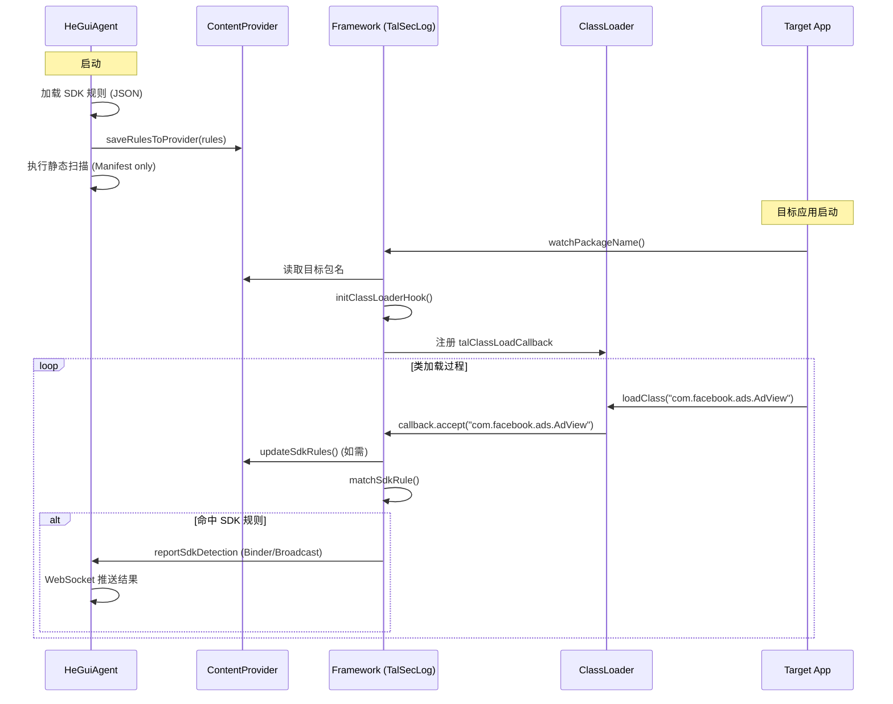

# SDK 检测功能实现说明文档

## 1. 功能概述

本项目实现了一套高效、全面的 Android 应用 SDK 集成检测方案，旨在帮助开发者和监管人员识别目标应用中集成了哪些第三方 SDK。

该方案采用了 **静态扫描** 与 **动态监测** 相结合的策略：

*   **静态扫描 (App端)**: 快速扫描应用的 `AndroidManifest.xml`，识别声明的组件（如 Activity, Service, Provider）是否包含 SDK 特征包名。此方式速度极快，无 I/O 瓶颈。
*   **动态监测 (System端)**: 在系统 Framework 层 Hook 类加载过程，实时监测应用运行时实际加载的类。这是主要的检测手段，能有效对抗加固、代码隐藏和动态加载。

两者的检测结果汇总后，通过 WebSocket 实时推送到前端展示。

## 2. 架构设计

*   **HeGuiAgent (Client App)**:
    *   负责加载规则库 (`android_sdk_rules.json`)。
    *   将规则下发给系统层 (`ContentProvider`)。
    *   执行静态 APK 扫描（仅 Manifest）。
    *   接收系统层上报的动态检测结果。
    *   统一展示结果。
*   **System Framework (AOSP)**:
    *   `TalSecLog`: 核心 Hook 点，负责读取规则、监测敏感行为和类加载。
    *   `ClassLoader` (Libcore): 插桩点，拦截类加载事件。
    *   `TalSecService`: 系统服务，负责跨进程通信。

## 3. 具体改动文件与实现细节

### 3.1 App 端 (HeGuiAgent)

#### `com/ayl/compliance/utils/SdkDetector.kt`
*   **功能**: 执行静态扫描，管理规则。
*   **改动**:
    *   **移除 Dex 扫描**: 为了极致效率，移除了对 `.dex` 文件的扫描逻辑。
    *   **移除 Deep Scan**: 删除了基于 Shell `grep` 的低效全盘扫描。
    *   **仅扫 Manifest**: 使用 `ZipFile` 流式读取 `AndroidManifest.xml`，并与 SDK 规则包名进行字符串包含匹配。
    *   **规则下发**: 新增 `saveRulesToProvider` 方法，将 JSON 规则序列化后存储到 `TalProvider`，供系统层读取。

#### `com/ayl/compliance/receiver/LocalInterfaces.kt` (新增)
*   **功能**: 定义本地 AIDL 接口存根。
*   **目的**: 解决 App 与 System Framework 之间因 AIDL 生成代码版本不一致导致的 `NoSuchMethodError` 问题，实现解耦。

#### `com/ayl/compliance/receiver/TalSecListenerStub.java` & `TalSecManagerProxy.kt`
*   **功能**: 手动实现 Binder 通信的 Stub 和 Proxy。
*   **实现**: 直接继承 `Binder` 并处理 `onTransact`，绕过系统自动生成的 Stub 类，确保跨进程通信的稳定性。

### 3.2 System 端 (Framework)

#### `libcore/ojluni/src/main/java/java/lang/ClassLoader.java`
*   **功能**: Java 类加载核心类。
*   **改动**:
    *   新增静态回调接口 `public static volatile Consumer<String> talClassLoadCallback`。
    *   在 `loadClass(String, boolean)` 方法入口处插入 Hook 点，调用该回调。

#### `frameworks/base/core/java/android/tal/TalSecLog.java`
*   **功能**: 监测逻辑核心。
*   **改动**:
    *   **初始化 Hook**: 在 `initClassLoaderHook` 中，向 `ClassLoader` 注册回调函数。仅针对目标监测应用生效，避免影响系统性能。
    *   **规则同步**: 实现 `updateSdkRules`，定期从 `ContentProvider` (`sdk_rules`) 拉取最新的 SDK 检测规则。
    *   **动态匹配**: 实现 `checkClassLoad` 和 `matchSdkRule`。当类加载发生时，检查类名是否包含 SDK 包名特征。
    *   **结果上报**: 命中规则后，通过 `reportSdkDetection` 发送广播或 Binder 调用，将 `detected_sdk` 和 `class_name` 上报给 `HeGuiAgent`。
    *   **开关控制**: 在 `showCallingStack` 中增加了对 `logswitch` 的检查，确保监测开关生效。

## 4. 检测流程图

## 5. 性能与优势

1.  **极速静态扫描**: 仅扫描 Manifest 文件，毫秒级完成，无感知。
2.  **精准动态监测**: 直接 Hook 类加载，无论应用如何加固、隐藏 Dex 文件，只要代码被执行（加载到内存），就能被捕获。
3.  **低侵入性**: 动态监测逻辑仅在目标应用进程中开启，对系统其他进程无影响。
4.  **实时性**: 运行时发现 SDK 立即上报，无需等待扫描结束。
